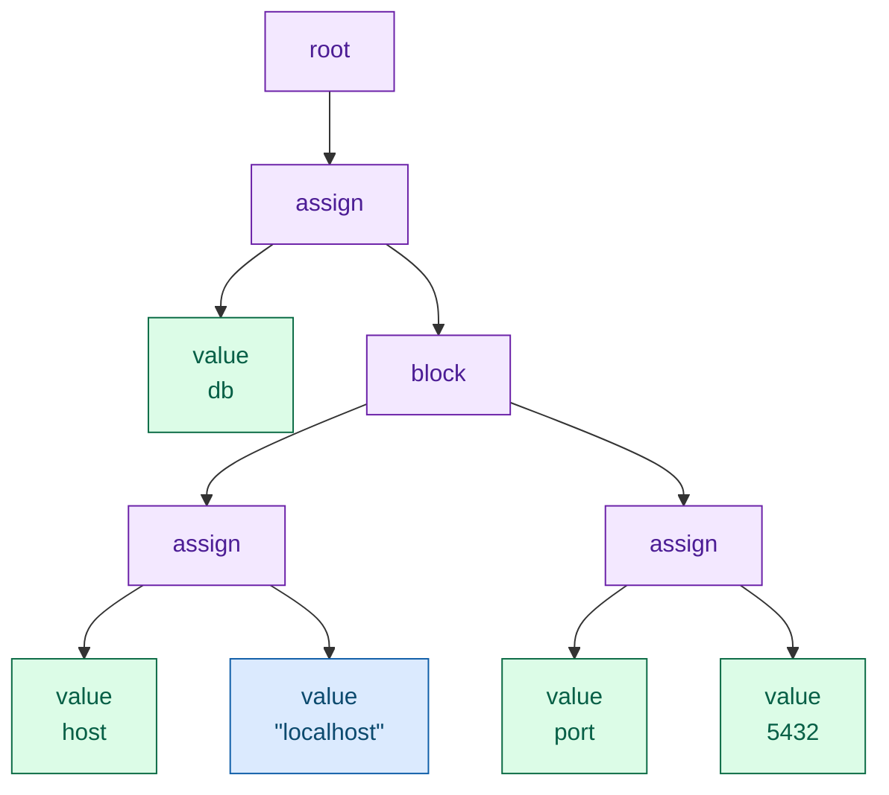
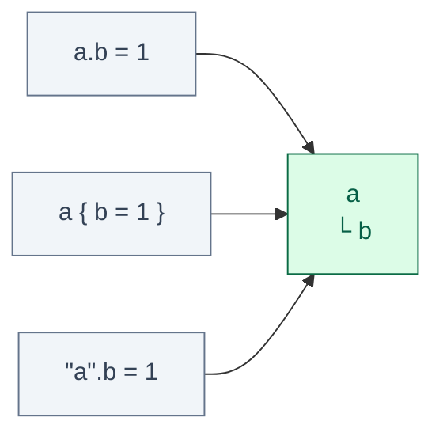

I have decided to build a tool that will resolve my configuration dilema for all languages at once. The tool has CLI interface and native programable interface.
Point it at a config file and it prints what your service will really read: includes spliced in, substitutions resolved against the environment it will run in, duplicate keys merged, the whole thing as JSON.
The ultimate config resolution tool.

The algorithm sits underneath the public API, sprinkled with Croatian salt and the sweat of morning runs, and made with love of programming, passion for learning and humble curiosity.
The code might not be beautiful, and might not withstand a pro-Zig developer's standards, but it beats lightbench/config, hocon-rs and pyhocon on performance, and most importantly on simplicity.

<!--more-->

When I started this project I had never written Zig.
I hungrily read Mitchell Hashimoto's [series on the Zig tokenizer](https://mitchellh.com/zig/tokenizer) and decided to jump in without knowing where it leads.
Enjoy the read: the obstacles I ran into and the techniques I picked.

The journey starts with the tokenizer.

## Tokenization

You always start with a file on a hard drive, or with a config map that ends up materialized as a file.
A tokenizer turns these bytes into labelled chunks of text.
Nothing more.
The tokenizer has no idea what a config file is and cannot tell you that `= = =` is nonsense, and that is the point: it answers one question per character and never looks back.

Let's dive in with an example.
Top is the content of a typical HOCON file, and bottom is what comes out (same colour for the same kind of token):

<div style="font-family:ui-monospace,SFMono-Regular,Menlo,monospace;font-size:0.9rem;background:#f8fafc;border:1px solid #e2e8f0;border-radius:8px;padding:1rem 1.1rem;overflow-x:auto;line-height:1.7">
<div style="white-space:pre;margin-bottom:1rem"><span style="color:#0b6b45;font-weight:600">db</span> <span style="color:#6b21a8;font-weight:600">{</span>
  <span style="color:#0b6b45;font-weight:600">host</span> <span style="color:#9a3412;font-weight:600">=</span> <span style="color:#0f5ea8;font-weight:600">"localhost"</span>
  <span style="color:#0b6b45;font-weight:600">port</span> <span style="color:#9a3412;font-weight:600">=</span> <span style="color:#0b6b45;font-weight:600">5432</span>
<span style="color:#6b21a8;font-weight:600">}</span></div>
<div style="display:flex;flex-wrap:wrap;gap:0.35rem;font-size:0.78rem">
<span style="background:#dcfce7;color:#0b6b45;border-radius:4px;padding:0.15rem 0.45rem">string <b>db</b></span>
<span style="background:#f3e8ff;color:#6b21a8;border-radius:4px;padding:0.15rem 0.45rem">l_brace <b>{</b></span>
<span style="background:#f1f5f9;color:#475569;border-radius:4px;padding:0.15rem 0.45rem">newline <b>⏎</b></span>
<span style="background:#dcfce7;color:#0b6b45;border-radius:4px;padding:0.15rem 0.45rem">string <b>host</b></span>
<span style="background:#ffedd5;color:#9a3412;border-radius:4px;padding:0.15rem 0.45rem">assignment <b>=</b></span>
<span style="background:#dbeafe;color:#0f5ea8;border-radius:4px;padding:0.15rem 0.45rem">quoted_string <b>"localhost"</b></span>
<span style="background:#f1f5f9;color:#475569;border-radius:4px;padding:0.15rem 0.45rem">newline <b>⏎</b></span>
<span style="background:#dcfce7;color:#0b6b45;border-radius:4px;padding:0.15rem 0.45rem">string <b>port</b></span>
<span style="background:#ffedd5;color:#9a3412;border-radius:4px;padding:0.15rem 0.45rem">assignment <b>=</b></span>
<span style="background:#dcfce7;color:#0b6b45;border-radius:4px;padding:0.15rem 0.45rem">string <b>5432</b></span>
<span style="background:#f1f5f9;color:#475569;border-radius:4px;padding:0.15rem 0.45rem">newline <b>⏎</b></span>
<span style="background:#f3e8ff;color:#6b21a8;border-radius:4px;padding:0.15rem 0.45rem">r_brace <b>}</b></span>
<span style="background:#f1f5f9;color:#475569;border-radius:4px;padding:0.15rem 0.45rem">eof</span>
</div>
</div>

Notice the following things:

- `5432` is a `string`. So is `true`, and so is `null`.
- Whitespace between the words is gone, but the newlines are not.
  - In HOCON a newline ends a value, so it carries meaning and has to survive.
  - Indentation has no meaning, so it does not survive.
- `assignment` is a special token, not a string.

Deciding that `5432` is a number does not happen here, because HOCON has no schema, unlike the PKL format.
HOCON lets you write `=` or `:` (JSON files are valid HOCON precisely because of that colon), so both arrive as the same tag.

I decided to model a token as:

```zig
pub const Token = struct {
    tag: Tag,
    loc: Loc,

    pub const Loc = struct { start: usize, end: usize };

    pub const Tag = enum {
        l_brace,
        r_brace,
        l_bracket,
        r_bracket,
        dollar_brace_optional,
        dollar_brace,

        string,
        quoted_string,
        multiline_string,
        newline,
        comma,
        assignment, // = or :

        invalid,
        eof,
    };
};
```

The token holds no text, only a tag and two offsets into the input buffer, so the bytes stay where they are and are available for further processing.
No copying, no allocator, which is why the tokenizer needs no memory management at all. **No memory management = faster execution**.
I took that wholesale from [Mitchell Hashimoto's walkthrough of the Zig tokenizer](https://mitchellh.com/zig/tokenizer), which is still the clearest explanation of the shape: keep a state, look at one character, decide whether the token has unambiguously ended.

Let's take one config line as an example:

```
host: "localhost"

string         @ 0..4   host
assignment     @ 4..5   :
quoted_string  @ 6..17  "localhost"
```

One HOCON trap lives entirely at this level: complicated strings need quotes, otherwise they get tokenized as if they were syntax. For example:

```
url = http://example.com

string      @ 0..3   url
assignment  @ 4..5   =
string      @ 6..10  http
assignment  @10..11  :
eof         @24..24
```

`//` starts a comment in HOCON wherever it appears, so the rest of the URL is a comment and your address is gone.
The tokenizer does not complain, it hands over `http` and a stray colon.
The parser does, and so does Java: *Expecting end of input or a comma, got ':'*. pyhocon happily gives you `"http://example.com"`, which is friendlier and not what the spec says.
The spec's advice is to quote URLs, which is good advice that nobody follows.

Maybe one day I will rewrite the tokenizer to use Zig's [labeled switch](https://ziglang.org/download/0.14.0/release-notes.html#Labeled-Switch), which arrived after Hashimoto's post was written.

Zig's own tokenizer got a 13% speedup out of that rewrite, which is not my reason.
My reason is that a state machine using labeled switch would be more readible than while loop.

I implemented the whole tokenizer in a few mornings and felt like the best developer ever.
I was a bit confused when I realized I did not have to allocate any memory, but I was proud and ready for the next stage, which I was hoping to finish in a couple of days too... how wrong I was!


## Parsing

Parsing is a very interesting part of the HOCON parser because it takes tokens and builds a tree while building the basic semantics of HOCON, hence raising the first portion of structural errors. 
Why a tree? HOCON nests to any depth, objects inside objects inside arrays, and I simply saw that shape as a tree in front of my eyes.

It works on tokens, never on characters, and unlike the tokenizer it always knows **where it is**: at the root, inside a block, inside an array, on the key side or the value side.

Opposite to the tokenizer, which only knew the current "word" forming a token, the parser is smarter and looks at one token into the future. 
Only one, no more! 
For that I wrapped the tokenizer into a struct holding the following methods:

```zig
fn peek(self: *Parser) Token   // look at the next token, do not consume it
fn next(self: *Parser) Token   // consume it
```

- Peek to decide, next to commit.
- One token of lookahead, no backtracking anywhere.

With just these two methods and structure-matching logic you can build the whole tree, and that is what I did. The nice part is that you can raise structural errors already on this layer if you need to. Every proper tree has a root, so I decided to introduce a root node as well.

Same file (scroll up if you need), run through it:



The colours carry over from the token diagram, and the interesting part is what is missing.
Both braces are gone, the `=` signs are gone, the newlines are gone.
They did their job by telling the parser what shape it was looking at, and the shape is now the tree itself.
What survives is the text of the leaves, and it survives *verbatim*: `"localhost"` keeps its quotes in the tree, because the difference between `"1"` and `1` is decided a few phases later and this is the only thing carrying it.

That is the rule I keep coming back to.
**Undecided is fine, lost is not.**

The tree above is boring on purpose. 
It is simple!
HOCON gets interesting one line further, at `a = ${db.host} ":" 5432`, where three values sit next to each other and what they mean together depends on types nobody knows yet.
The parser refuses to decide and stores the parts.

Writing the parser was a great ride which took me 10 evenings in August, ticking features off the list one by one while new ones kept getting added... sadly not 2 or 3 evenings, way more! The parser stands on a very generic function which is so simple to implement in a language you know, but writing it in a language you do not really know, and handling all allocations, is the shaping part... At this point I really appreciated Claude Code, which I was using as a tutor to save some time looking for information. By the way, Zig's documentation is borderline terrible, forcing you to read source code, which is a good thing when you know all the idioms... Also notice that all tests are pretty well documented: Claude wrote the tests, I wrote the implementation! 

At the end of Parsing I was tired and wanted to give up, but giving up is easy... so I left includes with syntax support only (they parse, but nothing splices the file in) and started with the final configuration graph necessary for resolution.

## Configuration graph

Tree outputing Parser is still very rough for users, users want to be able ask for `getFloat("a.b")` and get a `float` value. Especially, if `a.b` is something like this `a.b = ${c}`. If HOCON didnt support resolutions then we would not need the layer of code.

This is the stage I wrote through the end of August and into September, and it is in: `Value.zig` is 1248 lines and 25 tests, `Key.zig` another 137 lines of code, and `Config.zig` 155 lines forming the low level user interface.

To provide users with right values I do following:

```zig
pub fn parseFromSliceLeaky(comptime T: type, allocator: Allocator, file_content: [:0]const u8) !T {
        // Parse the file content
        var parser = Ast.Parser{ .gpa = allocator, .t = .{ .t = Tokenizer.init(file_content) } };
        const ast = try parser.parse();
        // Convert AST into Key-Values
        var obj = try Value.fromNode(allocator, ast);
        // Resolve includes and return the resolved object to users in structure they provide
        try obj.resolve(allocator);
        return parseFromValue(T, allocator, obj);
    }
```

The goal here is to provide user facing API as Zig as possible meaing, I got to look into standard JSON package for inspiriation.

At this layer we are bulding  a document from tree.
Three fields, written three ways, are one field:




All three arrows work. `a.b = 1` nests, `a { b = 1 }` joins the two spellings, `"a".b = 1` lands in the same place, giving `{"a":{"b":1}}`.
A number splits like any other unquoted string, so `1.5 = x` is `1 { 5 = x }`, which is what Java does too.
For a while the key side and the `${}` side split paths in two different places, and `${x."y.z"}` arrived as three elements instead of two.
Now there is one splitter and both sides go through it.

Then values merge by type, and the rules are short:

| written | result | rule |
|---|---|---|
| `a = 1` then `a = 2` | `2` | last wins |
| `a = {x:1}` then `a = {y:2}` | `{x:1, y:2}` | objects merge |
| `a = [1]` then `a = [2]` | `[2]` | lists do not, they replace |

The table is what the oracles say.
What the code does today is the concatenation half of it: two objects written next to each other merge by key, a key held by both merges again only if both sides hold an object, and anything else lets the right-hand value win, so `{b=[1]} {b=[2]}` is `[2]` and not the `[1,2]` a list concatenation would give.
The other way in, the same key written twice inside one block, `{b=1, b=2}`, used to reach the graph as two members.
Now it is `{"b":2}`, same as everywhere else.

What comes out is not a tree anymore, it is a value graph.
In August I expected it to carry two kinds of hole, a concatenation whose parts have not been joined and a reference that has not been looked up.
It carries one.
Concatenation turned out to belong to loading, the same place Java decides it: lists join flat, text parts join and stop being numbers, objects merge, and a string next to a list is the `WrongType` Java reports, raised while loading rather than later.
The whitespace between two parts goes whichever way its neighbours go, a separator beside a list or an object, a character beside text, and a *quoted* space is a value, so `[1] " " [2]` is an error where `[1]   [2]` is `[1,2]`.

The reference is the hole that stays.
A substitution is the one part nothing can be joined into, so the parts around it are kept in order and the value stays pending: `"1" ${x} [2]` loads and fails only once `x` turns out to be a number, while `"1" [2] ${x}` fails immediately.
Resolving it is the next stage, and the order is the whole reason this project exists:

```
a = 1
b = ${a}
a = 2        →  b is 2, not 1
```

A substitution resolves against the **finished** graph, not against what was visible above it.
Resolving during merge gives you `1`, which is exactly the pyhocon behaviour I am trying to get away from.
There is one exception, and it is the one that makes `+=` work at all:

```
a = 1
a = ${a} 2   →  "1 2"
```

Inside an assignment to `a`, `${a}` sees the previous value of `a`.
So the merge cannot throw the old value away until the new one is resolved, and a cycle (`a = ${b}`, `b = ${a}`) has to be an error rather than a hang.

None of that is written yet.
Today `+` does not even get past the tokenizer, and `include` is recognised where a member starts and then nothing splices the file in.

## Resolving

The graph that comes out of merging still has holes in it, `${x}` where a value should be.
Resolving fills them, and it runs once, after the whole file is loaded.
Four tests from the repo show all of it.
(The real code keeps an index per object and writes finished values back into the tree, so the second ref to the same place is free.
I leave both out here.
Same steps, just slower.)

**A ref sees the finished file.**
The test is called `a ref takes the last value of its target`:

```
x = 1
a = ${x}
x = 2
```

Before resolve even starts, merging has already happened.
The second `x` replaced the first one, so this is the root it gets:

```
root
├ x: 2
└ a: ${x}
```

Resolve walks the members in order:

```
x: 2       a number, nothing to do
a: ${x}    a ref: look up [x] from the root → 2
```

```
{"x":2,"a":2}
```

The `1` is gone long before anyone asks for it.
That is the whole late binding thing from the previous section, and it costs nothing, it falls out of the order: merge first, resolve second.

**Pending parts join.**
Second test, `pending parts join`:

```
x = [2]
l = [1] ${x} [3]
```

While loading, `[1]` and `[3]` could not be joined across `${x}`, nobody knew yet what `${x}` would be.
So `l` is kept as its parts, in order:

```
root
├ x: [2]
└ l: pending [ [1], ${x}, [3] ]
```

Resolve takes the parts one by one and glues them with the same `update` function loading uses:

```
[1]        a list, keep          → [1]
${x}       look up [x] → [2]     → [1] + [2] = [1, 2]
[3]        a list, keep          → [1, 2] + [3] = [1, 2, 3]
```

```
{"x":[2],"l":[1,2,3]}
```

Text works the same. `d = ${x}" ducks in a row"` with `x = 2` is `"2 ducks in a row"`, and the `2` stops being a number on the way.
Glued text is a string.

**An optional that finds nothing.** `${?x}` is the polite ref: if `x` does not exist, it is not an error, it just is not there.
The test is `an undefined optional in a concatenation leaves a string`:

```
a = ${?nope}42
```

No space between the two, but they are still two parts, a ref cannot be glued into anything:

```
root
└ a: pending [ ${?nope}, 42 ]
```

```
${?nope}   look up [nope] → nothing, optional → drop the part
42         the first part left, keep       → 42
           two parts were written, so text → "42"
```

```
{"a":"42"}
```

The spec says an undefined optional in a concatenation is an empty string, and empty string plus `42` is the string `"42"`. typesafe/config and pyhocon both drop the part and hand back the number `42`, as if the ref had never been written.
So this is one of the rows where I side with the spec against both oracles, and the suite has it as [`substitutions/039`](https://github.com/lejmr/zig-hocon/tree/main/conformance/suite/substitutions).
Written alone, `a = ${?nope}` does not become an empty string, the whole member disappears.
Same rule for a list element, `[1, ${?nope}, 2]` is `[1,2]`.

**A cycle is an error.**
Last one, `a cycle is an error`:

```
a { b = ${a} }
```

```
root
└ a
  └ b: ${a}
```

Resolve keeps a short list of the places it is working on right now.
That list is the only thing between this file and an infinite loop:

```
a: object, walk it
  b: ${a}   look up [a] → the object a
            resolve a                 working on: [a]
              b: ${a}   look up [a] → the object a again
                        a is on the list → SubstitutionCycle
```

`a` would be finished once `b` is, and `b` once `a` is. typesafe/config says `${a} was part of a cycle of substitutions`. pyhocon says `RecursionError: maximum recursion depth exceeded`.

The one case none of this handles yet is `a = ${a} 2`, where `${a}` means the *old* `a`.
By the time resolve runs, the old `a` has been merged away, so for now that is a cycle too.

## Types

Everything in that graph is still text. `5432` is the four characters it was in the file, `yes` is three.
That is the same rule again, undecided is fine: in HOCON a value means something only once a type asks for it, and `yes` is `true` if you want a `bool` and `"yes"` if you want a string.
So types show up last, and this is where Zig got interesting for me.

My first go at it was `config.get("a.b")` returning a string.
I deleted it before it compiled.
That is the Java API, and it drags in path parsing, a `getInt`/`getString` family and the question of who owns the returned slice.
What I actually want is what pydantic does, and replacing pydantic is why I started.
So the interface is the one a Zig programmer already knows from `std.json`:

```zig
const Server = struct {
    host: []const u8,
    port: u16 = 8080,
    tls: ?struct { cert: []const u8 } = null,
};

const parsed = try hocon.parseFromSlice(Server, gpa, source);
defer parsed.deinit();
```

Underneath it is one function with a `switch (@typeInfo(T))`.
I will admit I stared at that switch for a good while, totally lost, before it clicked. `@typeInfo` hands you a description of a type as an ordinary tagged union, the same kind of thing as my own `Value`: `.int` with its bit width, `.optional` with a `child`, `.@"struct"` with a slice of fields (the `@"…"` is only there because `struct` is a keyword).
The switch is decided at compile time, so for a `u16` the compiler builds a copy of the function that has nothing but the integer branch in it.
The struct branch walks its fields with `inline for`, because a field's type is a comptime value and a runtime loop cannot carry it, and recurses.
No codegen, no macros.
That is the whole trick.

Then the oracles again, this time asked for types instead of JSON, and not all the answers were the ones I expected:

- `timeout = 0.5` read as an integer is `0` in typesafe/config and in pyhocon.
No error.
Mine refuses: a fraction where a whole number belongs is a typo, and truncating it silently is how a timeout becomes zero.
- Booleans are `true`/`yes`/`on` and `false`/`no`/`off`, lowercase. pyhocon also takes `TRUE`.
Java does not.
- Asked for a string, Java gives you `1.50` back as written. pyhocon gives `"1.5"`, and `1e5` comes back as `"100000.0"`.
For something meant to replace pyhocon, that is a line in the migration notes.
- `null` read as an `int` is an error in Java and `None` in pyhocon.

`parsed` owns an arena with everything the result points to, the `Parsed(T)` shape from `std.json`, and `parseFromSliceLeaky` is its twin for when you bring your own arena.
The test for it found the only real bug of the week: unquoted text in the graph is a slice of the input buffer, not a copy.
Read a file, parse it, free the buffer, and every string in your struct points at freed memory.
The test now scribbles `x` over the source before it looks at the result.
(The other test I would recommend to anyone is `std.testing.checkAllAllocationFailures`.
It fails every allocation in turn and checks nothing leaks.
A handful of lines.)

## The command

And the command from the top of this post exists:

```
$ hocon server.conf
{"server":{"host":"example.org","port":8080,"tags":["a","b c"],"tls":"on"}}
```

`tls = on` stays a string there, because JSON has no `on`, and a number prints the way it was written. `main.zig` is 36 lines, since `std.json` finds a `jsonStringify` on `Value` by itself and does the printing.

It turned out more useful than I planned.
Path in, JSON out, non-zero exit on rejection is exactly the adapter contract of the [conformance suite](https://github.com/lejmr/zig-hocon/tree/main/conformance) in the repo, so the command is also how the parser gets scored.
First run: 248 of 436 against the spec. pyhocon gets 308, typesafe/config 390, and that last one is 89% against its own specification.
That gap is what went back upstream as [lightbend/config #860 to #865](https://github.com/lightbend/config/pulls?q=is%3Apr+author%3Alejmr), four merged so far. `main` with those four in it scores 403, 92%, and it is not released yet.
Most of what zig-hocon misses is simply not written yet: includes, `+=`.

## How fast

I did not plan to measure anything yet.
Then I got curious.
The same generated service configs, 1 KB to 10 MB, through all five implementations I have lying around, after checking they print identical JSON for the same file.
Apple M4 Pro, [the script is in the repo](https://github.com/lejmr/zig-hocon/tree/main/tools/bench).
Parse time with the process already warm:

| file | zig-hocon | hocon-rs 0.2 | hocon 0.9 (Rust) | typesafe/config | pyhocon |
|---|---:|---:|---:|---:|---:|
| 10 KB | 0.068 ms | 0.203 ms | 17.3 ms | 0.260 ms | 73.2 ms |
| 1 MB | 6.3 ms | 21.5 ms | — | 27.6 ms | 6.9 s |
| 10 MB | 65 ms | 234 ms | — | 300 ms | 70.9 s |

And the command a user actually runs, process start to exit:

| file | zig-hocon | hocon-rs 0.2 | typesafe/config | pyhocon |
|---|---:|---:|---:|---:|
| 1 KB | 2.4 ms | 3.3 ms | 47.4 ms | 84.0 ms |
| 10 MB | 97 ms | 314 ms | 745 ms | 70.1 s |

About 155 MB/s, and I have not optimised a single line.
The old `hocon` crate is quadratic (10 KB in 17 ms, 100 KB in 1.7 s), so it gets dashes for the big files; I stopped waiting.
Java's first parse of a 1 KB file takes 18.9 ms and the same parse warm takes 0.03 ms, which is a JIT story more than a parser story. pyhocon does about 145 KB/s, flat, for every size.
That is the thing I am trying to replace, three orders of magnitude down.

Two honest caveats. zig-hocon has no resolve pass yet and keeps no line number per value, and Java pays for both even on a file with nothing to resolve.
And the benchmark earned its keep before it printed a number: every run appends one line to a file, and only the last line survived.
Zig 0.16's `stdout().writer()` writes positionally, `pwrite` from offset 0, so `hocon a.conf >> out.json` overwrote the start of the file. `writerStreaming` fixed it ([fabd93a](https://github.com/lejmr/zig-hocon/commit/fabd93a)).

Of course I immediately wanted to do the [simdjson](https://arxiv.org/abs/1902.08318) thing.
So I measured first.
On the 10 MB file the tokenizer takes 10 ms, about 1 GB/s already, and that is 17% of the total.
The parser building the tree takes over half.
A tokenizer infinitely fast would buy 15%.
SIMD can wait.

Full disclosure: the `Parsed` wrapper, the JSON printer, the CLI plumbing and the benchmark harness are Claude Code's.
The conversion switch is mine, and it took me a lot of questions about what `T` even is at that point.

So point it at the four-line file from the top of this post and it tells the truth.
Point it at the file on your production box and it stops at the first `${` with `error: Unresolved`.
That is the next stage, and the next post.
