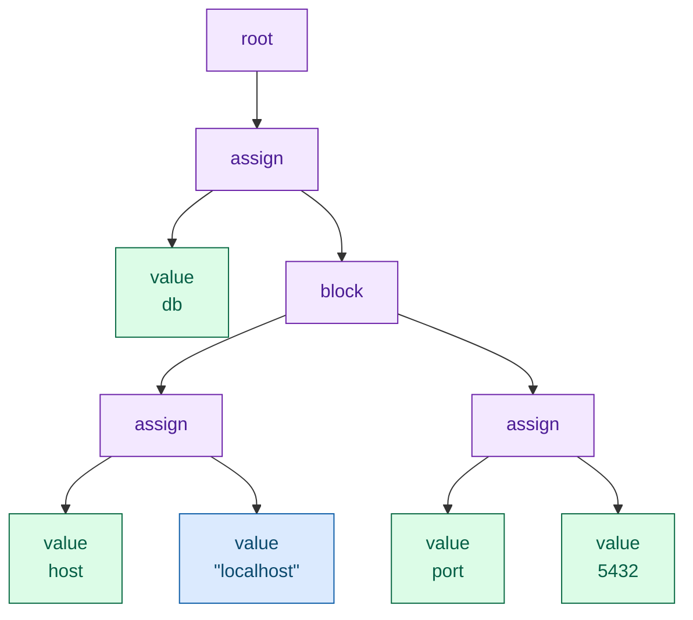
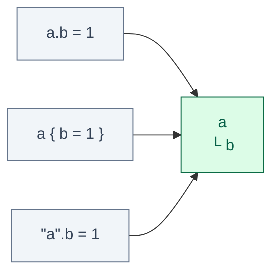
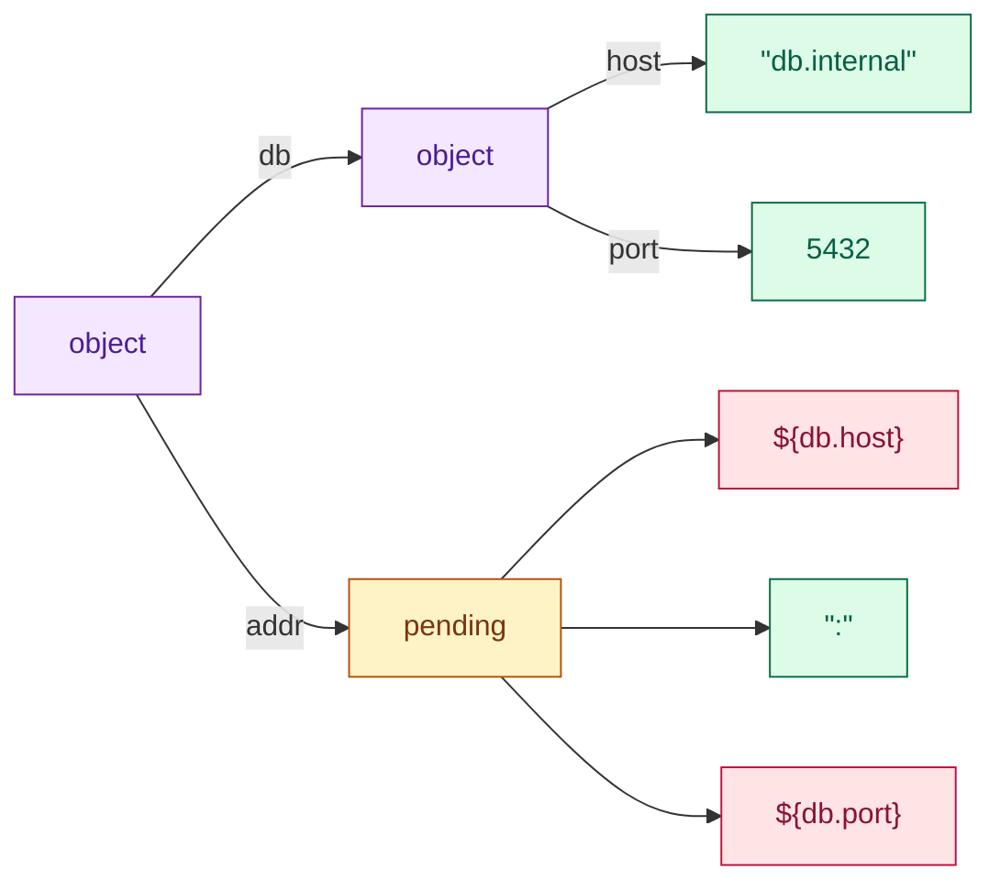
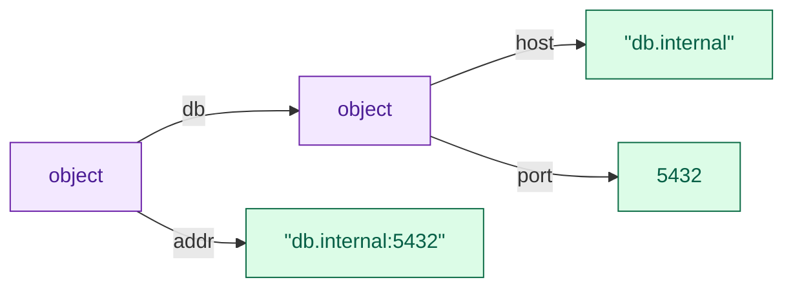

I have decided to build a tool that will resolve my configuration dilema for all languages at once. The tool has CLI interface and native programable interface.
Point it at a config file and it prints what your service will really read: includes spliced in, substitutions resolved against the environment it will run in, duplicate keys merged, the whole thing as JSON.
The ultimate config resolution tool.

The algorithm sits underneath the public API, sprinkled with Croatian salt and the sweat of morning runs, and made with love of programming, passion for learning and humble curiosity.
The code might not be beautiful, and might not withstand a pro-Zig developer's standards, but it beats lightbench/config, hocon-rs and pyhocon on performance, and most importantly on simplicity.

<!--more-->

When I started this project I had never written Zig.
I hungrily read Mitchell Hashimoto's [series on the Zig tokenizer](https://mitchellh.com/zig/tokenizer) and decided to jump in without knowing where it leads.
Enjoy the read: the obstacles I ran into and the techniques I picked.

The journey starts with the tokenizer.

## Tokenization

You always start with a file on a hard drive, or with a config map that ends up materialized as a file.
A tokenizer turns these bytes into labelled chunks of text.
Nothing more.
The tokenizer has no idea what a config file is and cannot tell you that `= = =` is nonsense, and that is the point: it answers one question per character and never looks back.

Let's dive in with an example.
Top is the content of a typical HOCON file, and bottom is what comes out (same colour for the same kind of token):

<div style="font-family:ui-monospace,SFMono-Regular,Menlo,monospace;font-size:0.9rem;background:#f8fafc;border:1px solid #e2e8f0;border-radius:8px;padding:1rem 1.1rem;overflow-x:auto;line-height:1.7">
<div style="white-space:pre;margin-bottom:1rem"><span style="color:#0b6b45;font-weight:600">db</span> <span style="color:#6b21a8;font-weight:600">{</span>
  <span style="color:#0b6b45;font-weight:600">host</span> <span style="color:#9a3412;font-weight:600">=</span> <span style="color:#0f5ea8;font-weight:600">"localhost"</span>
  <span style="color:#0b6b45;font-weight:600">port</span> <span style="color:#9a3412;font-weight:600">=</span> <span style="color:#0b6b45;font-weight:600">5432</span>
<span style="color:#6b21a8;font-weight:600">}</span></div>
<div style="display:flex;flex-wrap:wrap;gap:0.35rem;font-size:0.78rem">
<span style="background:#dcfce7;color:#0b6b45;border-radius:4px;padding:0.15rem 0.45rem">string <b>db</b></span>
<span style="background:#f3e8ff;color:#6b21a8;border-radius:4px;padding:0.15rem 0.45rem">l_brace <b>{</b></span>
<span style="background:#f1f5f9;color:#475569;border-radius:4px;padding:0.15rem 0.45rem">newline <b>⏎</b></span>
<span style="background:#dcfce7;color:#0b6b45;border-radius:4px;padding:0.15rem 0.45rem">string <b>host</b></span>
<span style="background:#ffedd5;color:#9a3412;border-radius:4px;padding:0.15rem 0.45rem">assignment <b>=</b></span>
<span style="background:#dbeafe;color:#0f5ea8;border-radius:4px;padding:0.15rem 0.45rem">quoted_string <b>"localhost"</b></span>
<span style="background:#f1f5f9;color:#475569;border-radius:4px;padding:0.15rem 0.45rem">newline <b>⏎</b></span>
<span style="background:#dcfce7;color:#0b6b45;border-radius:4px;padding:0.15rem 0.45rem">string <b>port</b></span>
<span style="background:#ffedd5;color:#9a3412;border-radius:4px;padding:0.15rem 0.45rem">assignment <b>=</b></span>
<span style="background:#dcfce7;color:#0b6b45;border-radius:4px;padding:0.15rem 0.45rem">string <b>5432</b></span>
<span style="background:#f1f5f9;color:#475569;border-radius:4px;padding:0.15rem 0.45rem">newline <b>⏎</b></span>
<span style="background:#f3e8ff;color:#6b21a8;border-radius:4px;padding:0.15rem 0.45rem">r_brace <b>}</b></span>
<span style="background:#f1f5f9;color:#475569;border-radius:4px;padding:0.15rem 0.45rem">eof</span>
</div>
</div>

Notice the following things:

- `5432` is a `string`. So is `true`, and so is `null`.
- Whitespace between the words is gone, but the newlines are not.
  - In HOCON a newline ends a value, so it carries meaning and has to survive.
  - Indentation has no meaning, so it does not survive.
- `assignment` is a special token, not a string.

Deciding that `5432` is a number does not happen here, because HOCON has no schema, unlike the PKL format.
HOCON lets you write `=` or `:` (JSON files are valid HOCON precisely because of that colon), so both arrive as the same tag.

I decided to model a token as:

```zig
pub const Token = struct {
    tag: Tag,
    loc: Loc,

    pub const Loc = struct { start: usize, end: usize };

    pub const Tag = enum {
        l_brace,
        r_brace,
        l_bracket,
        r_bracket,
        dollar_brace_optional,
        dollar_brace,

        string,
        quoted_string,
        multiline_string,
        newline,
        comma,
        assignment, // = or :

        invalid,
        eof,
    };
};
```

The token holds no text, only a tag and two offsets into the input buffer, so the bytes stay where they are and are available for further processing.
No copying, no allocator, which is why the tokenizer needs no memory management at all. **No memory management = faster execution**.
I took that wholesale from [Mitchell Hashimoto's walkthrough of the Zig tokenizer](https://mitchellh.com/zig/tokenizer), which is still the clearest explanation of the shape: keep a state, look at one character, decide whether the token has unambiguously ended.

Let's take one config line as an example:

```
host: "localhost"

string         @ 0..4   host
assignment     @ 4..5   :
quoted_string  @ 6..17  "localhost"
```

One HOCON trap lives entirely at this level: complicated strings need quotes, otherwise they get tokenized as if they were syntax. For example:

```
url = http://example.com

string      @ 0..3   url
assignment  @ 4..5   =
string      @ 6..10  http
assignment  @10..11  :
eof         @24..24
```

`//` starts a comment in HOCON wherever it appears, so the rest of the URL is a comment and your address is gone.
The tokenizer does not complain, it hands over `http` and a stray colon.
The parser does, and so does Java: *Expecting end of input or a comma, got ':'*. pyhocon happily gives you `"http://example.com"`, which is friendlier and not what the spec says.
The spec's advice is to quote URLs, which is good advice that nobody follows.

Maybe one day I will rewrite the tokenizer to use Zig's [labeled switch](https://ziglang.org/download/0.14.0/release-notes.html#Labeled-Switch), which arrived after Hashimoto's post was written.

Zig's own tokenizer got a 13% speedup out of that rewrite, which is not my reason.
My reason is that a state machine using labeled switch would be more readible than while loop.

I implemented the whole tokenizer in a few mornings and felt like the best developer ever.
I was a bit confused when I realized I did not have to allocate any memory, but I was proud and ready for the next stage, which I was hoping to finish in a couple of days too... how wrong I was!


## Parsing

Parsing is a very interesting part of the HOCON parser because it takes tokens and builds a tree while building the basic semantics of HOCON, hence raising the first portion of structural errors. 
Why a tree? HOCON nests to any depth, objects inside objects inside arrays, and I simply saw that shape as a tree in front of my eyes.

It works on tokens, never on characters, and unlike the tokenizer it always knows **where it is**: at the root, inside a block, inside an array, on the key side or the value side.

Opposite to the tokenizer, which only knew the current "word" forming a token, the parser is smarter and looks at one token into the future. 
Only one, no more! 
For that I wrapped the tokenizer into a struct holding the following methods:

```zig
fn peek(self: *Parser) Token   // look at the next token, do not consume it
fn next(self: *Parser) Token   // consume it
```

- Peek to decide, next to commit.
- One token of lookahead, no backtracking anywhere.

With just these two methods and structure-matching logic you can build the whole tree, and that is what I did. The nice part is that you can raise structural errors already on this layer if you need to. Every proper tree has a root, so I decided to introduce a root node as well.

Same file (scroll up if you need), run through it:



The colours carry over from the token diagram, and the interesting part is what is missing.
Both braces are gone, the `=` signs are gone, the newlines are gone.
They did their job by telling the parser what shape it was looking at, and the shape is now the tree itself.
What survives is the text of the leaves, and it survives *verbatim*: `"localhost"` keeps its quotes in the tree, because the difference between `"1"` and `1` is decided a few phases later and this is the only thing carrying it.

That is the rule I keep coming back to.
**Undecided is fine, lost is not.**

The tree above is boring on purpose. 
It is simple!
HOCON gets interesting one line further, at `a = ${db.host} ":" 5432`, where three values sit next to each other and what they mean together depends on types nobody knows yet.
The parser refuses to decide and stores the parts.

Writing the parser was a great ride which took me 10 evenings in August, ticking features off the list one by one while new ones kept getting added... sadly not 2 or 3 evenings, way more! The parser stands on a very generic function which is so simple to implement in a language you know, but writing it in a language you do not really know, and handling all allocations, is the shaping part... At this point I really appreciated Claude Code, which I was using as a tutor to save some time looking for information. By the way, Zig's documentation is borderline terrible, forcing you to read source code, which is a good thing when you know all the idioms... Also notice that all tests are pretty well documented: Claude wrote the tests, I wrote the implementation! 

At the end of Parsing I was tired and wanted to give up, but giving up is easy... so I left includes with syntax support only (they parse, but nothing splices the file in) and started with the final configuration graph necessary for resolution.

## The tree is not the config

A tree is what the parser makes, and nobody wants a tree.
You want `port` as a `u16`, and you want it even when the file says `port = ${defaults.port}`.
If HOCON had no substitutions this layer would not exist, the leaves could go straight to the type conversion.
It has them, so between the tree and your struct sits one more stage, the one I wrote through the end of August and into September: [`Value.zig`](https://github.com/lejmr/zig-hocon/blob/main/src/Value.zig), 1438 lines and 34 tests and [`Key.zig`](https://github.com/lejmr/zig-hocon/blob/main/src/Key.zig) for paths.

The whole pipe is four lines, and they are the rest of this post:

```zig
pub fn parseFromSliceLeaky(comptime T: type, allocator: Allocator, source: [:0]const u8) !T {
    var parser = Ast.Parser{ .gpa = allocator, .t = .{ .t = Tokenizer.init(source) } };
    const ast = try parser.parse();                 // bytes → tokens → tree
    var doc = try Value.fromNode(allocator, ast);   // tree → one document, merged
    try doc.resolve(allocator);                     // fill the ${} placeholders
    return parseFromValue(T, allocator, doc);       // document → your struct
}
```

The first job is the `fromNode` line, a document out of a tree.
Three fields, written three ways, are one field:



All three arrows work. `a.b = 1` nests, `a { b = 1 }` joins the two spellings, `"a".b = 1` lands in the same place, giving `{"a":{"b":1}}`.
To simplify logistics around keys I added `Key.zig` which tackles all posible variants of key and normalizes it, so the comma traversal is very simple.

**What a value is.** The whole layer is one tagged union in [`Value.zig`](https://github.com/lejmr/zig-hocon/blob/main/src/Value.zig):

```zig
pub const Value = union(enum) {
    scalar: Scalar,     // the text as written, plus whether it was quoted
    array: []Value,
    object: []Member,   // key and value, in written order
    ref: Ref,           // a path, plus whether it was ${?}
    pending: []Value,   // parts of a concatenation that could not be joined yet
};
```
`ref` and `pending` are the interesting one because they are here to deal with referencing. A `pending` is a row of values that sit next to each other in the file and could not be joined, because one of them is a ref.
Everything else is finished the moment it is built. Internally, I am merging everything I can before I run into reference the same after reference. The same applies to concatenation, e.g., `1 "2"` is "1 2" or `[1]   [2]` is `[1,2]`,

Nothing is looked up at this point. That is deliberate, lets have example:

```
db { host = "localhost", port = 5432 }
addr = ${db.host}":"${db.port}
db.host = "db.internal"
```

The `db` block from the tokenizer example, two lines longer. This is the document after loading, before anything is looked up:

```
object
├ db: object
│  ├ host: scalar "db.internal"
│  └ port: scalar 5432
└ addr: pending [ ref [db, host], scalar ":", ref [db, port] ]
```



`db` is finished, the third line already merged into the first. `addr` could not be joined, so it holds its three parts in order: a placeholder with a path in it, the text, another placeholder. Resolving then gives `{"db":{"host":"db.internal","port":5432},"addr":"db.internal:5432"}`: `addr` sees `db.internal`, not the `localhost` that was above it in the file.

Writing this layer took seven evenings and one morning, from 25 August to 13 September. The composing itself was not hard. What was hard is that by now the structures were nested a few levels deep, and the Zig debugging ecosystem is still early, so looking into some variables either failed or showed nothing. CodeLLDB in Zed was the first round of that, [written up separately](/posts/zig-debugging-in-zed/); today I am on my patched ZigBrains.


## Resolving

As already indicated the resolution is necessary to convert references to actuall values. 
It runs once, after the whole file is loaded, and replaces every `ref` and `pending` in the graph with a finished value. 
After resolution the config `object` has `pending`s emptied in favour of scalaras, arrays, or objects.
The same file as above, through the pass. Resolving walks the top object in order, finds the two refs inside `addr`, fills them from the finished `db`, merges the three parts, and writes the result back:



```
{"db":{"host":"db.internal","port":5432},"addr":"db.internal:5432"}
```

`addr` sees `db.internal`, the value `db.host` ended up with, and the `5432` stops being a number on the way, because it was merged to text.
After ten evenings of parser I expected this part to be the hard one. It turned out to be OK.

Resolve is called on the main object and does bfs to converting all `ref` and `pending` values while for pending performs update operation.

There is one case that is not yet implemented, e.g., `a = ${a} 2`, where `${a}` means the *old* `a`.
Which means the library needs to adjust update logic in this case, and then even the syntax suger `+=` will be doable.


## Types

Up until now everything happened inside HOCON. To use the resolved config without pain you need a typed, programmable interface, and HOCON has no types: there is no schema, so the schema has to live in the program. This chapter is about that.

Everything in the graph is still text. `5432` is four characters, `yes` is three, and both stay that way until a type asks for them.

My first go at it was `config.get("a.b")` returning a string.
I deleted it before it compiled, because I could not explain to myself how I would use it from Zig.
What I actually want is what pydantic does, and replacing pydantic is why I started.
So the interface is the one a Zig programmer already knows from `std.json`:

```zig
const Server = struct {
    host: []const u8,
    port: u16 = 8080,
    tls: ?struct { cert: []const u8 } = null,
};

const parsed = try hocon.parseFromSlice(Server, gpa, source);
defer parsed.deinit();
```

Underneath it is one function in [`Config.zig`](https://github.com/lejmr/zig-hocon/blob/main/src/Config.zig), `parseFromValue`.
I did not know where to start, so I spent a while reading `std.json` and asking Claude what a Zig user would expect.
Then it turned out to be surprisingly easy: walk the fields of the struct and convert each one.
The conversion is a `switch (@typeInfo(T))`, decided at compile time, so for a `u16` the compiler builds a copy of the function with nothing but the integer branch in it.
The branches:

- `.int`: the scalar's text through `std.fmt.parseInt`, base 10. So `0.5` where an integer belongs is an error, and `70000` into a `u16` is an error, not a wrap.
- `.bool`: `true`/`yes`/`on` and `false`/`no`/`off`, lowercase, nothing else.
- `.float`: `std.fmt.parseFloat`.
- `[]const u8`: the text, copied into the result's memory. Any other slice is a list, converted item by item.
- `.@"struct"` (the `@"…"` is only there because `struct` is a keyword): `inline for` over the fields, because a field's type is a comptime value and a runtime loop cannot carry it. A field with a member of that name gets it, converted recursively. A field without one gets its default value, or `null` if it is optional, or the whole thing fails with `MissingField`. Keys the struct has no field for are ignored.
- Unquoted `null` is not a value of any of those. `"null"` with quotes is the string `null`.

## The command

Since I have HOCON parser working it was just necessary to implement it as a command that returns JSON formated config file.

```
$ hocon server.conf
{"server":{"host":"example.org","port":8080,"tags":["a","b c"],"tls":"on"}}
```

`tls = on` stays a string there, because JSON has no `on`, and a number prints the way it was written. `main.zig` is 36 lines, since `std.json` finds a `jsonStringify` on `Value` by itself and does the printing.

This interface turned out more useful than I planned.
Path in, JSON out, non-zero exit on rejection is exactly the adapter contract of the [conformance suite](https://github.com/lejmr/zig-hocon/tree/main/conformance) in the repo, so the command is also how the parser gets scored.
Scored before resolving landed: 251 of 445 against the spec. pyhocon gets 312, typesafe/config 1.4.9 gets 399, and that last one is 90% against its own specification.


## How fast

I did not plan to measure anything yet.
Then I got curious.
The same generated service configs, 1 KB to 10 MB, through all five implementations I have lying around, after checking they print identical JSON for the same file.
Apple M4 Pro, [the script is in the repo](https://github.com/lejmr/zig-hocon/tree/main/tools/bench).
Parse time with the process already warm:

| file | zig-hocon | hocon-rs 0.2 | hocon 0.9 (Rust) | typesafe/config | pyhocon |
|---|---:|---:|---:|---:|---:|
| 10 KB | 0.068 ms | 0.203 ms | 17.3 ms | 0.260 ms | 73.2 ms |
| 1 MB | 6.3 ms | 21.5 ms | — | 27.6 ms | 6.9 s |
| 10 MB | 65 ms | 234 ms | — | 300 ms | 70.9 s |

And the command a user actually runs, process start to exit:

| file | zig-hocon | hocon-rs 0.2 | typesafe/config | pyhocon |
|---|---:|---:|---:|---:|
| 1 KB | 2.4 ms | 3.3 ms | 47.4 ms | 84.0 ms |
| 10 MB | 97 ms | 314 ms | 745 ms | 70.1 s |

About 155 MB/s, and I have not optimised a single line.
The old `hocon` crate is quadratic (10 KB in 17 ms, 100 KB in 1.7 s), so it gets dashes for the big files.
Java's first parse of a 1 KB file takes 18.9 ms and the same parse warm takes 0.03 ms, which is a JIT story more than a parser story. pyhocon does about 145 KB/s, flat, for every size.

Of course I immediately wanted to do the [simdjson](https://arxiv.org/abs/1902.08318) thing, but that would be another project.
SIMD has to wait.

Full disclosure: a lot happened with Claude Code because all that is CLI plumbing and oracle preparation in various languages, etc..
The conversion switch and the resolve pass are mine, and the switch took me a lot of questions about what `T` even is at that point.


# Conclusion

Here we are, Zig has semi working HOCON parser and I feel way more confident in Zig than in June 26". 
I am planning to use this project in my other Zig projects because good configuration layer is key to the success.